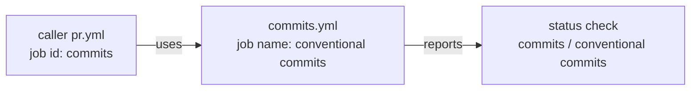

<h1>Required Status Checks - Names Produced by the Reusable Workflows</h1>

<h2>Table of Contents</h2>

[[_TOC_]]

## Overview

The `main-protection` ruleset (README, section 5) requires status checks by name. This page
explains how GitHub forms the name of a check produced by a reusable workflow, lists the
names each workflow of this repository produces, and gives the procedure to collect the real
names from a pull request before making them required.

This document is read on GitHub, so its diagram uses the fenced Mermaid block on purpose.

## Context

A caller workflow in a project (for example `pr.yml`) declares a job whose `uses:` points at
a reusable workflow of this repository. GitHub reports one status check per job of the
reusable workflow, and its name is composed from both sides:

```text
<caller job id> / <reusable job name>
```

- `<caller job id>` is the key of the job in the caller workflow (`commits:`, `security:`).
- `<reusable job name>` is the `name:` of the job inside the reusable workflow (falls back
  to the job id when no `name:` is set).

The caller decides the first half, so two projects calling the same workflow under different
job ids produce different check names. Names must be unique inside one repository: an
ambiguous required check blocks every merge.



A caller job id and a reusable job name combine into one status check name.

## Technical View

### Names produced by each reusable workflow

The table assumes the caller job ids of the README examples (section 8). Replace the first
half if a project uses different job ids.

| Reusable workflow | Job name inside the workflow | Suggested caller job id | Resulting check name |
|---|---|---|---|
| `commits.yml` | `conventional commits` | `commits` | `commits / conventional commits` |
| `security.yml` | `gitleaks` | `security` | `security / gitleaks` |
| `security.yml` | `zizmor` | `security` | `security / zizmor` |
| `release.yml` | `release` | `version` | `version / release` |

`release.yml` runs on `push` to `main`, so its check is never a pull request requirement; it
is listed for completeness.

### Names produced in this repository

`self-ci.yml` runs on every pull request of this repository and calls the reusable workflows
locally, which gives the fixture coverage the README asks for.

| Workflow | Job | Check name |
|---|---|---|
| `self-ci.yml` | `lint` | `actionlint and zizmor` |
| `self-ci.yml` | `commits` (calls `commits.yml`) | `commits / conventional commits` |
| `self-ci.yml` | `security` (calls `security.yml`) | `security / gitleaks` |
| `self-ci.yml` | `security` (calls `security.yml`) | `security / zizmor` |

These four names are the `required_checks` value for `github-standards` in `terraform/`
(milestone S3).

### Collecting the names from a real pull request

Read the names as GitHub reports them instead of deriving them by hand, then set
`required_checks` and switch the ruleset to `active` (README, section 9).

```bash
gh pr checks <number> --repo <owner>/<repository>
gh api "repos/<owner>/<repository>/commits/<head sha>/check-runs" --jq '.check_runs[].name'
```

## Risks and Limitations

| Risk | Impact | Mitigation |
|---|---|---|
| Renaming a job in a reusable workflow | Every consumer's required check stops reporting and blocks merges | Treat a job `name:` as part of the public contract; a rename is a breaking change of the reusable workflow |
| Two caller jobs with the same id in one repository | Ambiguous required check | Job ids are unique per workflow file, but keep them unique across files too |
| A required check that never runs (path filter, skipped job) | The pull request cannot be merged | Do not path-filter the workflows that produce required checks; roll out with the ruleset in `disabled` mode first |
| Check names contain spaces | Copy errors in `required_checks` | Copy the names from `gh pr checks` output |

## Best Practices

- Set the job `name:` explicitly in every reusable workflow; never rely on the job id.
- Keep caller job ids identical across projects (`commits`, `security`, `version`) so the
  `required_checks` lists stay identical too.
- Follow the README order for adoption: callers merged with the ruleset `disabled`, names
  read from a pull request, `required_checks` set, ruleset switched to `active`.

## Appendix

### Revision History

| Version | Date | Author | Changes |
|---|---|---|---|
| 1.0 | 2026-09-22 | Manuel Carrillo | Initial version (milestone S1) |
